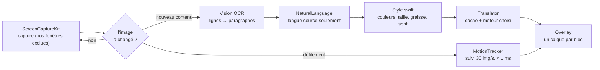
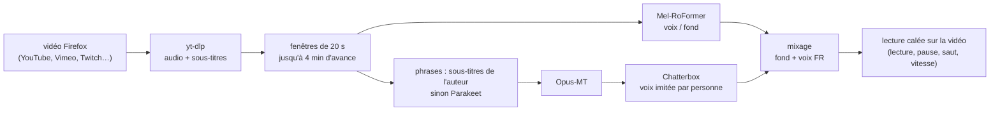

<div align="center">

# 🌍 MyTranslate v2

**Traduction anglais ↔ français en temps réel, 100 % sur ton Mac.**
Le texte de l'écran, les pages web et même la voix des vidéos — sans rien envoyer sur Internet.


</div>

---

## ✨ Les trois modules

| Module | Ce qu'il fait | État |
|---|---|---|
| 🖥️ **Texte à l'écran** | traduit le texte de n'importe quelle app **par-dessus l'original**, en gardant la taille, la graisse, la police et les couleurs ; suit le défilement en direct | ✅ stable (v0.4) |
| 🌐 **Pages web** (extension Firefox) | traduit la page **sur place** : liens, boutons et scripts du site continuent de fonctionner ; traduction automatique des pages en anglais | ✅ stable (v0.7) |
| 🎧 **Écouter traduit** | **double les vidéos** en français avec une voix qui imite la personne qui parle, la voix d'origine retirée, la musique et les bruits conservés | 🧪 expérimental (v0.3) |

---

## 🚀 Installer

### 1. L'app
1. Télécharge **`MyTranslate-2.0.0-macOS.zip`** dans la [release MyTranslate v2.0.0](https://github.com/Flavien-Audinet/Projet-IA-de-traduction-temps-reel/releases/tag/MyTranslate-v2.0.0).
2. Dézippe, glisse `MyTranslate.app` dans **Applications**, puis **clic droit › Ouvrir** au premier lancement (app non notariée).
3. macOS demande l'autorisation **Enregistrement de l'écran** (Réglages Système › Confidentialité et sécurité) : accorde-la puis relance l'app.

Le moteur **Apple** fonctionne tout de suite (télécharge une fois les langues depuis le menu). Les moteurs IA et le doublage demandent l'environnement Python ci-dessous.

### 2. L'extension Firefox
- **Pour essayer** : télécharge `MyTranslate-Extension-Firefox-0.7.0.zip`, dézippe, puis `about:debugging` › *Ce Firefox* › *Charger un module complémentaire temporaire* › `manifest.json` (l'extension disparaît au redémarrage de Firefox).
- **Pour l'installer pour de bon** : signe-la avec tes propres clés Mozilla (https://addons.mozilla.org/developers/addon/api/key/), puis glisse le `.xpi` produit dans Firefox :
  ```sh
  AMO_JWT_ISSUER='user:…' AMO_JWT_SECRET='…' ./sign_extension.sh
  ```
  Les clés ne sont lues que depuis l'environnement, jamais enregistrées.

### 3. Les moteurs IA (optionnel : Opus-MT, IA locale, doublage)

```sh
brew install uv ffmpeg
E="$HOME/Library/Application Support/MyTranslate"
uv venv --python 3.12 "$E/venv"
VIRTUAL_ENV="$E/venv" uv pip install torch transformers sentencepiece ctranslate2 \
    mlx mlx-lm mlx-whisper mlx-audio numpy scipy soundfile sounddevice yt-dlp
# IA locale (au choix) :
"$E/venv/bin/hf" download mlx-community/gemma-4-e4b-it-4bit
```

Les modèles sont téléchargés une fois dans `~/.cache/huggingface`. Ensuite l'app force `HF_HUB_OFFLINE=1` : **aucun accès réseau**.

### Compiler soi-même
Command Line Tools suffisent (`xcode-select --install`), pas besoin d'Xcode :
```sh
./build.sh           # -> build/MyTranslate.app
./build.sh install   # -> /Applications/MyTranslate.app
```

---

## 🖥️ Texte à l'écran

L'app vit dans la barre des menus (icône bulle).

| Raccourci | Mode |
|---|---|
| `⌃⌥W` | **Fenêtre active** : traduit en continu la fenêtre au premier plan (suit le défilement et les changements d'app) |
| `⌃⌥R` | **Zone choisie** : dessine un rectangle, seule cette zone est traduite (jeux, vidéos) |
| `⌃⌥F` | **Écran entier** : tout l'écran sous la souris |

Le même raccourci arrête la traduction.



1. **Capture** : la fenêtre, la zone ou l'écran. Une image n'est traitée que si son contenu a changé.
2. **OCR** (`Vision`) : lignes de texte et positions, regroupées en paragraphes traduits d'un bloc pour garder le sens.
3. **Langue** : seul le texte dans la langue source est traduit (pas les URL, heures, nombres, ni le texte déjà en français).
4. **Style mesuré dans les pixels** : couleurs du fond et du texte, taille déduite de la hauteur d'x, graisse de l'épaisseur des traits, serif / sans-serif du contraste des traits. Calibré sur SF Pro, Helvetica, Georgia et Times de 12 à 28 pt.
5. **Suivi du mouvement** : décalages estimés sur l'image réduite, puis vérifiés au pixel près sur ~400 points de chaque bloc. La surimpression suit le défilement **sans attendre l'OCR** ; un bloc dont le contenu change est masqué. Zones fixes (barres latérales, en-têtes) gérées.
6. **Cadence de l'OCR** bridée pour ne pas surchauffer le GPU : relancée quand l'image se stabilise (120 ms) ou au plus toutes les 0,7 s en mouvement, en mode rapide (~50 ms au lieu de ~550 ms).
7. **Rendu** : une fenêtre transparente (qui laisse passer la souris) recouvre chaque bloc avec la couleur du fond et y écrit la traduction ; sur une photo ou une vidéo, le fond est flouté.

**Réglages avancés** (menu › *Réglages avancés…*, appliqués en direct) : suivi (images/s, tolérance, prédiction), OCR (précis / rapide, stabilisation), rendu (taille ×0,7 à ×1,5, police, graisse, débordement), moteurs, débogage (cadres du suivi, compteurs en direct).

---

## 🌐 Extension Firefox

- **Sur place** : seul le contenu des nœuds texte est remplacé, le site continue de fonctionner normalement.
- **Ordre intelligent** : d'abord ce qui est visible (plus un écran d'avance), puis le reste de la page et le contenu chargé au défilement (défilement infini, applis React).
- **Pages complexes** : shadow DOM (Reddit), cadres intégrés, changements de page sans rechargement (YouTube), texte réécrit par le site.
- **Automatique** : toute page en anglais (attribut `lang`, puis échantillon du texte) est traduite dès son chargement ; case *« Jamais sur ce site »*.
- **Raccourcis** : bouton de l'extension ou `⌥⇧T` pour traduire / revenir à l'original ; maintenir `⌥` pour voir l'original.
- **Images** : le texte des images et des `<canvas>` peut être lu par l'OCR de l'app.
- Elle passe par l'app (service local `127.0.0.1:8770`) : même moteur et même cache que l'app.

---

## 🎧 Écouter traduit (expérimental)

### Vidéos web, préparées à l'avance (`⌃⌥A`, mode par défaut)
Au lieu de doubler pendant qu'on écoute, le doublage est préparé **en avance sur la ligne de temps** de la vidéo :



- **Une voix stable par personne** (empreinte de voix, regroupement par interlocuteur), **aucun doublon ni chevauchement**, fondus et léger effet de salle.
- **La vidéo n'est pas modifiée** : l'extension coupe son son quand le doublage est prêt et la met en pause avec un indicateur tant qu'il ne l'est pas. Les publicités YouTube gardent leur son.
- **Mesuré** : démarrage ~12 s sur une vidéo jamais vue, saut ~8 s, ~70 s d'avance en régime établi.

### Mode direct (son de n'importe quelle app, en différé)
Le son de l'app est capturé (process tap Core Audio), séparé, transcrit, traduit, revoisé, puis rejoué avec un délai D (~7 s) ; l'extension retarde l'image des vidéos Firefox du même délai.

---

## 🧠 Moteurs de traduction

| Moteur | Points forts | Vitesse |
|---|---|---|
| **Apple** (framework Translation) | hors-ligne, aucune installation, meilleure qualité que l'IA locale | instantané |
| **Rapide — Opus-MT** (Université d'Helsinki) | spécialisé traduction, GPU (MPS fp16), repli processeur (CTranslate2) | ~9 000 caractères/s |
| **IA locale** (MLX : Gemma 4 E4B ou Qwen 3.6 35B-A3B) | tient compte du contexte de la page | ~0,35 s par ligne |

---

## 🔒 Sécurité et vie privée

- **Tout est local** : capture, OCR, traduction, voix. Les modèles tournent hors-ligne.
- **Services locaux protégés** : l'app et ses moteurs n'écoutent que sur `127.0.0.1` et **refusent les requêtes des sites web** (contrôle des en-têtes `Origin`, `Host` et `Sec-Fetch-Site`). Une page malveillante ne peut ni piloter la traduction, ni lancer un téléchargement, ni lire un fichier, même par *DNS rebinding* (`Engine/local_guard.py`, `Sources/Translate/LocalAPI.swift`).
- Le moteur de doublage n'accepte que des adresses `http(s)://` (les fichiers locaux sont réservés aux tests, avec `DUB_ALLOW_LOCAL_FILES=1`).
- Les clés de signature Mozilla ne sont jamais écrites dans le code.

---

## 🗂️ Organisation des fichiers

```
MyTranslate_v2/
├── build.sh                         compilation sans Xcode (+ install dans /Applications)
├── sign_extension.sh                signature privée de l'extension (clés Mozilla en variables d'env)
├── Resources/
│   ├── Info.plist                   identité de l'app (l'identifiant est complété par build.sh)
│   └── make_extension_icons.swift   génère les icônes de l'extension
├── Sources/                         l'app (Swift)
│   ├── App/
│   │   ├── MyTranslateApp.swift     barre des menus, raccourcis, fenêtre des langues
│   │   ├── SettingsView.swift       fenêtre « Réglages avancés »
│   │   └── Tuning.swift             réglages partagés, appliqués en direct
│   ├── Screen/
│   │   ├── Capture.swift            ScreenCaptureKit
│   │   ├── OCR.swift                Vision + paragraphes + détection de langue
│   │   ├── Style.swift              mesures typographiques et couleurs
│   │   ├── MotionTracker.swift      suivi du défilement image par image
│   │   ├── Overlay.swift            fenêtre de surimpression, un calque par bloc
│   │   ├── RegionSelector.swift     sélection d'une zone à la souris
│   │   └── ScreenTranslator.swift   orchestration des 3 modes
│   ├── Translate/
│   │   ├── Translator.swift         cache + moteurs Apple / IA locale
│   │   ├── OpusEngine.swift         lance et interroge le moteur Opus-MT
│   │   ├── LocalEngine.swift        lance le serveur MLX (IA locale)
│   │   ├── Tagged.swift             texte balisé (liens, mise en forme) pour le web
│   │   ├── ImageOCR.swift           OCR des images envoyées par l'extension
│   │   └── LocalAPI.swift           service 127.0.0.1:8770 pour l'extension (protégé)
│   ├── Audio/
│   │   ├── ProcessTap.swift         capture du son d'une app (Core Audio)
│   │   └── DubController.swift      pilotage du doublage (⌃⌥A)
│   ├── Util/                        géométrie, raccourcis clavier globaux
│   └── Debug/RenderTest.swift       modes test hors écran (--render, --track-test)
├── Engine/                          moteurs IA (Python, embarqués dans l'app)
│   ├── mt_server.py                 Opus-MT, 127.0.0.1:8767
│   ├── dub_server.py                doublage direct, 127.0.0.1:8769
│   ├── dub_ahead.py                 doublage anticipé des vidéos, 127.0.0.1:8771
│   └── local_guard.py               protection commune contre les requêtes des sites web
├── Extension/                       extension Firefox
│   ├── manifest.json
│   ├── core.js                      logique testable (découpage, balises, ordre de traduction)
│   ├── content.js                   traduction de la page
│   ├── background.js                lien avec l'app, onglet propriétaire du doublage
│   ├── video.js                     synchronisation des vidéos pour le doublage
│   ├── images.js                    texte des images et canvas
│   ├── popup.html / popup.js        fenêtre de l'extension
│   └── icons/
└── Tests/extension/                 tests jsdom (core, démarrage auto, onglets)
```

**Mode test sans autorisation d'écran** :
`build/MyTranslate.app/Contents/MacOS/MyTranslate --render capture.png sortie.png [--engine local|fake] [--lines]`

---

## 💻 Compatibilité

| | |
|---|---|
| **macOS** | 15 Sequoia ou plus récent (framework Translation, process tap Core Audio) |
| **Processeur** | Apple Silicon requis (MLX, GPU Metal) — testé sur M3 Max 48 Go |
| **Mémoire** | le doublage charge plusieurs modèles IA à la fois et demande beaucoup de mémoire ; l'écran et le web avec le moteur Apple sont légers |
| **Navigateur** | Firefox (extension) ; Chrome non testé |
| **Langues** | anglais ↔ français |
| **Limites connues** | vidéos protégées par DRM (Netflix…) : le son est doublé mais l'image ne peut pas être retardée ; plein écran natif d'une `<video>` non couvert en mode direct |

---

## 🧭 En cours de développement

- [ ] **Doublage** : voix plus réaliste, moins de petites coupures (~1 par minute quand la parole est dense, le GPU est le facteur limitant) ; piste : modèle de voix plus rapide / quantifié.
- [ ] **Suivi du défilement** : encore quelques décrochages sur certaines pages.
- [ ] **Taille du texte** parfois trop petite dans la surimpression (réglage disponible, cause en cours d'analyse).
- [ ] **Extension** : publication signée.
- [ ] **Plus tard** : un modèle de traduction entraîné maison (dans l'esprit de la [version 2024](../README.md)).

---

<div align="center"><sub>SwiftUI · Vision · ScreenCaptureKit · MLX · Opus-MT · Chatterbox — tout tourne sur ton Mac<br/>© Tous droits réservés — voir l'avertissement du <a href="../README.md">dépôt</a></sub></div>
